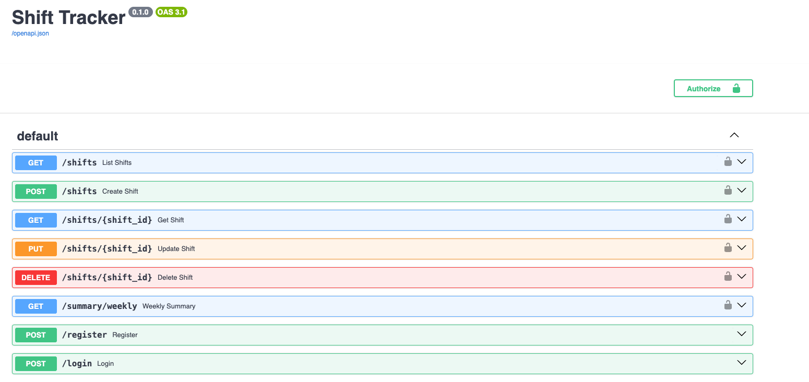

# shift-tracker

A REST API for anyone that's struggling to log shifts and see hours and pay, including overnight shifts, with private accounts so each user only sees their own data.

**Live demo:** https://YOUR-APP.onrender.com/docs *(free hosting: the app sleeps when idle and the database resets on redeploy)*



## Features

- Add, view, edit and delete shifts (venue, date, start, end, hourly rate, notes)
- Hours and pay are calculated on the way out, never stored, and handle overnight shifts (22:00 to 04:00 is 6 hours)
- Weekly summary with the number of shifts, total hours and total pay
- Register and log in with argon2-hashed passwords and JWT tokens that expire after 2 hours
- Users can only see and change their own shifts
- Automated tests and CI on every push

## Tech used

Python 3.14, FastAPI, SQLAlchemy, SQLite, Pydantic, PyJWT, pwdlib (argon2), pytest, Docker, GitHub Actions

## Run locally

```bash
git clone https://github.com/YOUR-USERNAME/shift-tracker.git
cd shift-tracker
python3 -m venv venv
source venv/bin/activate
python -m pip install -r requirements.txt
python -m uvicorn main:app --reload
```

Open http://127.0.0.1:8000/docs

## Run with Docker

```bash
docker compose up --build
```

Open http://127.0.0.1:8000/docs. The database is stored in a local `data/` folder, so it survives restarts. Before using real data, replace the placeholder `SECRET_KEY` in `docker-compose.yml` with a long random value (anyone who knows the key can forge a login).

## Run the tests

```bash
python -m pytest
```

Tests use a temporary in-memory database, so they never touch real data.

## Endpoints

| Method | Path | Description | Login needed |
|---|---|---|---|
| POST | /register | Create an account | No |
| POST | /login | Get a token | No |
| POST | /shifts | Add a shift | Yes |
| GET | /shifts | List your shifts, newest first | Yes |
| GET | /shifts/{id} | Get one shift | Yes |
| PUT | /shifts/{id} | Replace a shift | Yes |
| DELETE | /shifts/{id} | Delete a shift | Yes |
| GET | /summary/weekly?week_start=YYYY-MM-DD | Totals for the 7 days from that date | Yes |

Requesting another user's shift returns 404, not 403, so nobody can discover which ids exist.

## What I learned

- Overnight shifts were the reason I built this. A 22:00 to 04:00 shift has an end time earlier than its start, so I convert both to minutes and add 24 hours when the end isn't later than the start. I also learned not to store hours and pay: if the rate or a time is edited, a stored copy goes out of date.
- Security needs proof. I wrote a two-user test (user A creates a shift, user B must see an empty list and get a 404). When I removed the `user_id` filter on purpose, the test failed, which showed it would catch that exact bug.
- Tests and Docker made the project easy to trust and easy to run. A temporary in-memory database keeps tests away from real data, and one `docker compose up --build` runs the whole app with the database kept outside the container.

## What I would add next

- Add database migrations with Alembic and move to a hosted PostgreSQL database, so data survives redeploys
- A monthly summary
- A way to revoke a stolen login token
- A small front end that talks to the API